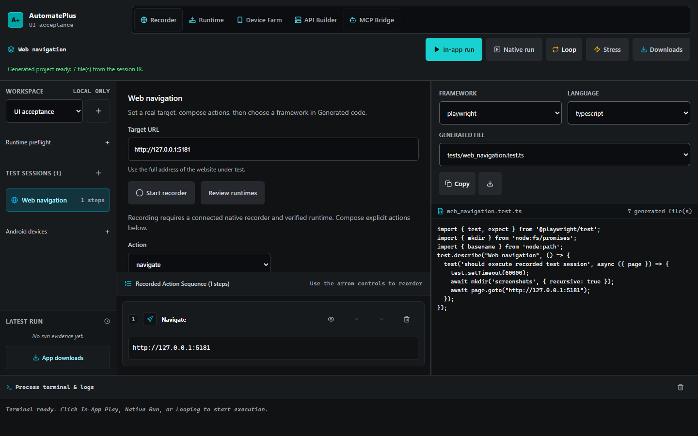
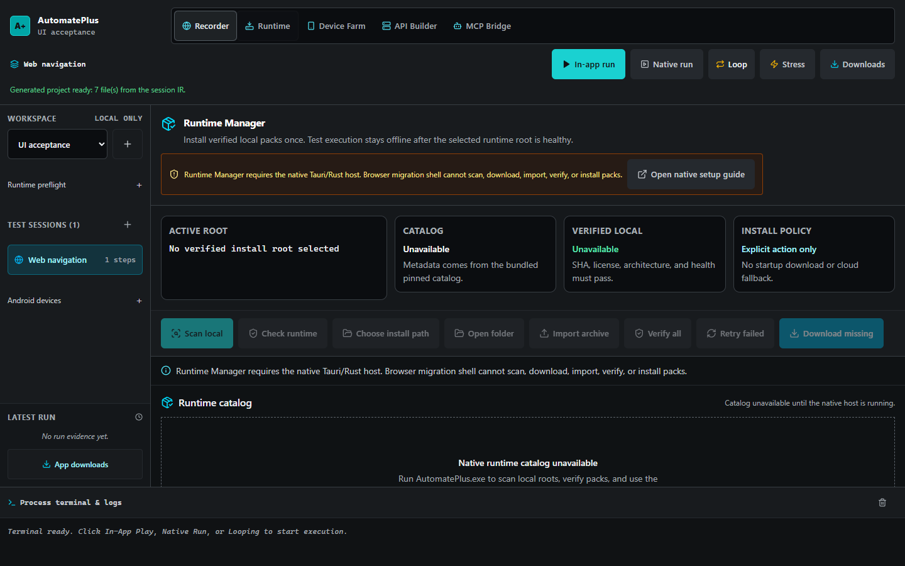

# AutomatePlus

Dibuat oleh **Adrian Syah Abidin**.

Workbench desktop Windows untuk SDET: susun SessionIR, pilih framework/bahasa,
dan ekspor project automation Web, Android atau API. Native host memakai
**Tauri 2 + Rust**; renderer, generator dan sidecar memakai **TypeScript**.
Control plane lokal tanpa cloud, telemetry atau download otomatis.

## Download dan buka satu klik

[Download v1.7.1 Windows x64 portable ZIP](https://github.com/Adrian463588/AutomatePlus/releases/download/v1.7.1/AutomatePlus-v1.7.1-windows-x64.zip)
· [SHA-256](https://github.com/Adrian463588/AutomatePlus/releases/download/v1.7.1/SHA256SUMS.txt)
· [Riwayat versi](https://github.com/Adrian463588/AutomatePlus/releases)

1. Verifikasi ZIP dengan `Get-FileHash .\AutomatePlus-v1.7.1-windows-x64.zip -Algorithm SHA256`; cocokkan dengan `SHA256SUMS.txt`.
2. Ekstrak **seluruh ZIP** ke folder lokal yang writable.
3. Klik dua kali **Run-AutomatePlus.bat** di folder hasil ekstraksi.

ZIP menyertakan aplikasi native dan BAT; tidak memerlukan Node.js/Cargo untuk
membuka aplikasi. Windows 10/11 x64 dan **Microsoft Edge WebView2 Runtime** harus
sudah terpasang. BAT saja bukan paket aplikasi. Binary preview belum ditandatangani;
verifikasi checksum dan sumber unduhan, jangan menonaktifkan proteksi Windows.

**v1.7.1 adalah portable preview, bukan klaim seluruh automation production-ready.**
Runtime/recording/execution yang belum terverifikasi tetap disabled atau `Blocked`.
Bootstrap dan installer WebView2 offline belum disertakan. Browser migration shell
bukan pengganti native host atau bukti physical-device acceptance.

## Alur penggunaan

1. **Workspace → Create project**: isi nama dan pilih folder dengan dialog Windows.
   Browser migration mode hanya menerima path manual, tanpa akses filesystem native.
2. **Create session**: pilih Web, Android atau API; tidak ada project/target bawaan.
3. **Recorder/editor**: masukkan target nyata dan susun action/locator/assertion.
   Recorder hanya tersedia ketika native recorder serta runtime-nya siap.
4. **Generated code**: pilih framework, bahasa dan file; Copy/Export memakai hasil
   generator dari session tersebut, bukan template target simulasi.
5. **Runtime Manager**: scan, verify dan health-check dependency lokal. Download
   hanya setelah root dipilih, metadata resmi lengkap, license diterima dan mode
   online onboarding diaktifkan secara eksplisit.
6. **Device Farm**: pilih device ADB authorized. Eksekusi membutuhkan package/activity
   nyata dan Appium/UiAutomator2 serta runtime lain yang sudah diverifikasi.

Generator mencakup **27 kombinasi**: 13 Web, 9 Android, 5 API. Validasi parser/unit
bukan bukti semua generated project telah berjalan pada target fisik. Locator
ranked/self-healing hanya menggunakan kandidat yang benar-benar tercatat, dibatasi
jumlah retry, dan tidak mengubah kegagalan menjadi pass.

## Live preview

Gambar berikut adalah render aktual browser migration UI; bukan native/device evidence.





[Preview mobile 390px](assets/ui/workbench-mobile.png)

## Offline, runtime dan batas acceptance

Aplikasi, persistence dan control plane berjalan lokal. Akses website/API publik
memerlukan jaringan ke target ketika user memulai tes; itu bukan layanan cloud
AutomatePlus. Jangan menyamakan offline host dengan website eksternal yang offline.

Runtime Manager memakai catalog lokal. SHA-256, license, arsitektur, executable
allowlist dan health command harus valid sebelum pack diterima. Metadata unresolved
menjadi `NeedsReview`; tidak ada silent install/fallback. Online onboarding hanya
melalui aksi user dengan `AUTOMATEPLUS_RUNTIME_DOWNLOAD=1`.

Status UI/component, native build, runtime-pack readiness, online target dan physical
Android dipisahkan di [spec dan evidence v1.7.1](specs/uiux-workbench-release-1.7.1.md).
Paket runtime yang belum lengkap bukan fabricated success. Tidak ada uninstall,
reset atau penghapusan data device sebagai acceptance workaround.

## Launcher dan pengembangan

Satu entrypoint resmi: `Run-AutomatePlus.bat`.

```powershell
.\Run-AutomatePlus.bat
.\Run-AutomatePlus.bat --help
# Perintah berikut membutuhkan source checkout dan toolchain lokal:
.\Run-AutomatePlus.bat --doctor
.\Run-AutomatePlus.bat --build-dev
.\Run-AutomatePlus.bat --browser --no-open --port=5173
```

Default membuka EXE native; tidak fallback ke browser. Exit code: `0` normal,
`1` gagal, `2` prerequisite/argumen blocked. Launcher tidak download atau install.

Source: `backend/` Rust/Tauri, `frontend/` React/TypeScript + sidecar/packages,
`scripts/` gates dan packaging. `PRD.md`, `DESIGN.md`, `AGENTS.md`, `specs/`
adalah kontrak aktif. `reference/` dan `docs/` adalah research read-only.

```powershell
npm ci --offline
npm run lint
npm run format:check
npm run typecheck
npm test
npm run build
npm run verify:ui-contract
npm run verify:anti-slop
npm run verify:authenticity
npm run verify:memory-bounds
npm run native:check
npm run native:build
```

`npm run verify:ui-browser -- --mcp-server=<installed-playwright-mcp-cli>` menjalankan
BDD browser lokal melalui Playwright MCP yang **sudah terpasang**, tanpa auto-install.
DevTools memakai `--server-kind=devtools` dan CLI MCP lokal. Gate Cargo offline
menguji cache reproducible, bukan melarang provisioning development eksplisit.

## Riwayat versi

| Versi | Distribusi |
|---|---|
| [v1.7.1](https://github.com/Adrian463588/AutomatePlus/releases/tag/v1.7.1) | Windows portable preview, ZIP + checksum; UI/regression fixes |
| [v1.7.0](https://github.com/Adrian463588/AutomatePlus/releases/tag/v1.7.0) | Snapshot source historis; tidak ada binary aplikasi |

Hanya asset yang benar-benar dipublikasikan yang disebut tersedia. [MIT License](LICENSE).
