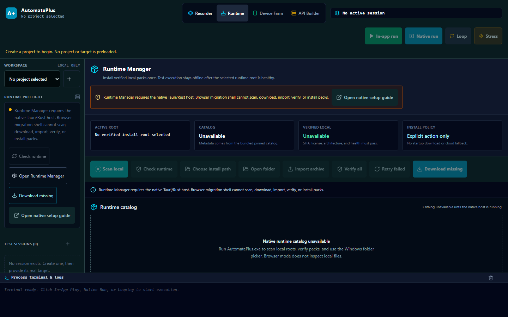
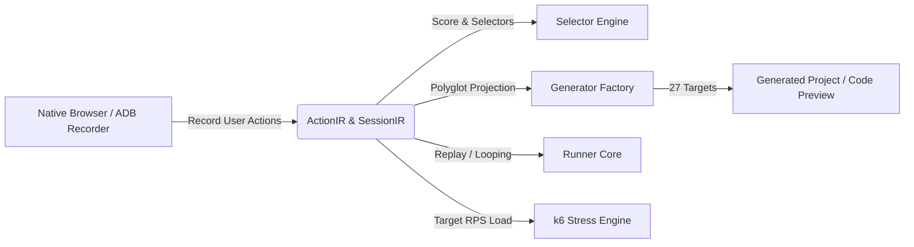

# AutomatePlus (Sprint 2)

[](https://github.com/Adrian463588/AutomatePlus)
[](https://github.com/Adrian463588/AutomatePlus)
[](https://github.com/Adrian463588/AutomatePlus)
[](https://github.com/Adrian463588/AutomatePlus/releases/latest)
[](https://github.com/Adrian463588/AutomatePlus)

> **AutomatePlus** is an offline-first Windows desktop platform for low-code multiplatform test automation. It bridges visual recording, unified intermediate representations (IR), and polyglot code generation across **Web**, **Android**, and **API** ecosystems.

**Dibuat oleh Adrian Syah Abidin.**

The renderer follows the **Precision Workbench** contract: neutral dark surfaces, cyan as the primary action accent, semantic status colors, native controls, restrained state-driven motion, and no decorative gradients or glass effects. Functional bento grouping is used only where it improves task hierarchy; the runtime and device screens use the full available work area, while generated-code space is reserved for Recorder and API Builder only.



Fresh AntiSlop workbench previews: [Runtime Manager](docs/assets/precision-workbench-runtime-1440x900.png) · [Device Farm](docs/assets/precision-workbench-device-farm-1440x900.png)

Runtime Manager responsive previews: [390×844](docs/assets/runtime-manager-preview-390x844.png) · [600×900](docs/assets/runtime-manager-preview-600x900.png) · [768×1024](docs/assets/runtime-manager-preview-768x1024.png) · [840×1024](docs/assets/runtime-manager-preview-840x1024.png) · [1024×768](docs/assets/runtime-manager-preview-1024x768.png) · [1280×800](docs/assets/runtime-manager-preview-1280x800.png) · [1440×900](docs/assets/runtime-manager-preview-1440x900.png)

Responsive previews: [390×844](docs/assets/sprint-2-preview-390x844.png) · [600×900](docs/assets/sprint-2-preview-600x900.png) · [768×1024](docs/assets/sprint-2-preview-768x1024.png) · [840×1024](docs/assets/sprint-2-preview-840x1024.png) · [1024×768](docs/assets/sprint-2-preview-1024x768.png) · [1280×800](docs/assets/sprint-2-preview-1280x800.png) · [1440×900](docs/assets/sprint-2-preview-1440x900.png)

The previews are captured from the current renderer in a fresh local browser profile with Playwright. They show the truthful empty/blocked state: no project, target package, device, generated code, or synthetic run result is created until the user supplies real data and the native host provides it. The current 390×844 and 1440×900 images include the Runtime Manager setup guidance and dark native-select treatment.

## Evidence and acceptance boundaries

The current component evidence includes 160 passing TypeScript tests and 21 passing Rust tests, the generator package tests, lint, format, typecheck, package/sidecar/React builds, documentation checks, the 27-combination generator matrix, sidecar capability smoke, a separately named loopback k6 fixture, and an authenticity scan. The target-named SauceDemo, DemoQA, ReqRes, Petstore, and NotiPlus suites in Vitest are fixture-bound component tests; they are not evidence that those external targets or physical devices were automated. A fresh Playwright audit rendered Runtime Manager and the main workspace at `390x844`, `600x900`, `768x1024`, `840x1024`, `1024x768`, `1280x800`, and `1440x900`; each rendered document reported `scrollWidth === innerWidth`, every visible interactive control was at least 48 px high, and the clean reload had no application console errors.

The OOM/EOF hardening gate is `npm run verify:memory-bounds`. Runtime and release SHA-256 checks now stream fixed 64 KiB chunks in Node and Rust; the gate hashed a 128 MiB sparse pack in a child process restricted to 32 MiB old-space. IPC records and SessionIR have explicit 8 MiB/1,000-step limits, runtime metadata and artifact queries are bounded, sidecar stdout handles backpressure/close/timeouts, follower observations and native runtime/farm/process jobs are bounded, ZIP extraction has expanded-size limits, and k6 caps local load settings, requires real metrics, performs bounded file reads, and waits for process-tree cleanup instead of exposing raw `Unexpected end of JSON input`.

The Web generator gate is explicit: `npm run verify:web-generators` materializes all 13 Web framework/language combinations against real SauceDemo and DemoQA URLs, checks JavaScript syntax, TypeScript transpilation, Python compilation, runtime metadata, every action declared by each Web capability manifest, and assertion metadata fallback. The latest local report is `.automateplus/evidence/web-generators-1787593852298.json` (ignored local evidence). Its 26 target projects and 13 action/assertion contracts are `GeneratedAndParsed`; runner execution remains `Blocked`/`NeedsReview` until the verified local framework packages, browsers/drivers, Python wheels, Maven cache, and Robot executable are installed through Runtime Manager. This distinction is intentional: a generated source check is not a real-browser pass.

The API generator gate is `npm run verify:api-generators`. It materializes the HTTP TypeScript, HTTP JavaScript, HTTP Python, HTTP Java, and k6 JavaScript projects against the declared real ReqRes and Petstore endpoints, validates generated syntax/metadata, and records measured direct target checks only when `AUTOMATEPLUS_ONLINE_E2E=1` is explicitly set. ReqRes remains `Blocked` without `AUTOMATEPLUS_REQRES_API_KEY`; generated runner execution remains `Blocked` until the pinned Axios, Python, Maven, and k6 packs are installed and health-verified locally. HTTP JavaScript/TypeScript outputs are standalone ESM runners (`npm run build && node dist/...`) and do not depend on undeclared `describe`/`expect` globals.

The Android generator gate is `npm run verify:android-generators`. It discovers an authorized ADB device at runtime, verifies the installed `com.notifplus/.MainActivity`, captures the live hierarchy hash, and ranks only observed semantic selectors. The live NotiPlus search field was empty during the audit, so `fill` is blocked unless an explicit test value is supplied; this prevents empty or fabricated generated actions:

```powershell
$env:AUTOMATEPLUS_ANDROID_GENERATOR_FILL_VALUE = 'NotiPlus'
npm run verify:android-generators
```

When the live hierarchy contains a real semantic input selector and that explicit test input is supplied, fill generation is enabled. If NotiPlus exposes no `EditText`/input selector, fill remains `Blocked` even when a value is provided; the verifier never invents an input target. The other observed-action contracts are generated and parsed across all 9 Android combinations. Every generated project includes `automateplus.manifest.json` and an exact-version `automateplus.runtime.json` lock. Appium runners require the leased device/Appium/port environment at execution time; Espresso and Robolectric retain the resolved target activity and require the real target Android Gradle project; Maestro retains its real `appId` and offline runtime-pack requirements. Physical replay remains a separate `Blocked` gate until a verified farm runtime pack and native IPC replay are available.

The API Builder was exercised manually against the real Petstore `GET /v2/store/inventory` endpoint using an explicit user click; it returned measured HTTP 200, persisted status/header assertions into `SessionIR`, and the generated preview contained exactly one request after a repeated send. ReqRes is currently `Blocked` because the service requires `AUTOMATEPLUS_REQRES_API_KEY`; no credential is fabricated. A real Petstore 404 was rendered as an HTTP error and returned the action to the ready state. This is explicit target-online browser evidence, not native offline acceptance.

Native Tauri/Rust acceptance remains explicitly `Blocked` because this checkout has no verified runtime packs. The backend `Cargo.lock`, offline Cargo cache, Rust toolchain, `cargo-tauri`, and installed WebView2 detection are healthy; `native:preflight` reports those facts separately from the missing runtime packs. The current `adb devices -l` snapshot contains no connected device, so NotiPlus and multi-device acceptance cannot be rerun. An earlier single-device Appium 2.10.3/UiAutomator2 3.5.5 probe reached the local server but was blocked by Android `SecurityException` for inaccessible secondary user `150`; no policy bypass was attempted. This is physical-device setup evidence, not a farm pass. The React/Vite application is a browser-safe migration shell; it does not fabricate native runtime or device evidence.

### Sprint 2 Android device farm

Sprint 2 adds a local Windows device-farm contract without introducing cloud services:

- `single`, `all-devices`, and `split-iterations` replay strategies with bounded workers and one lease per ADB serial.
- Device profiles/groups with stable local IDs, serial snapshots, preflight, port leases, and per-device evidence.
- Primary/follower Android recording: one canonical `ActionIR`, independent follower locator observations, and explicit mismatch/review states.
- One generated project per framework/language with required per-device runtime context; no hard-coded serials or Appium ports.

Farm runtime acceptance requires at least two authorized physical devices, a real target package/activity, and checksum-verified offline Appium/UiAutomator2/scrcpy packs. Unit tests and browser-shell previews remain component/prototype evidence only.

---

## 📌 Project Overview

AutomatePlus empowers QA engineers, developers, and automation specialists to visually record, inspect, parameterize, and run tests without vendor lock-in. Instead of proprietary binary scripts, every recorded interaction translates into canonical, versioned JSON Intermediate Representation (`SessionIR` & `ActionIR`), which projects into **27 capability-checked framework/language combinations**. The production target is Tauri 2 + Rust with a versioned TypeScript sidecar and React renderer; ordinary browser mode remains a safe migration shell.

### Core Philosophy
1. **Low-Code Visual Recording**: Click-and-record interactions through the native headed browser, interactive WebDriver canvas, and ADB device bridge.
2. **Canonical IR as Single Source of Truth**: The IR maintains semantic selectors, gesture coordinates, parameters, assertions, schema versions, and secret references. Generated code is a pure, deterministic projection.
3. **True Polyglot Multiplatform**: Generate capability-checked runnable project candidates for 5 Web frameworks, 4 Android frameworks, and 2 API runners across Python, TypeScript, JavaScript, Java, Kotlin, and YAML.
4. **Explicit Runtime Boundaries**: Host-side runners execute real local processes. Missing runtimes, devices, or project prerequisites are reported as `Blocked`; no simulator result is acceptance evidence.
5. **Offline & Secure by Design**: Runs entirely locally on Windows with zero cloud telemetry requirements and explicit `${secret.KEY}` credential isolation.

---

## 🛠️ Technology Stack

| Layer | Technologies |
|---|---|
| **Production Desktop GUI** | Tauri 2, Rust, WebView2, React 18 |
| **Native orchestration** | Rust ADB/Appium/scrcpy, SQLite, leases, ports, cancellation |
| **Renderer and sidecar** | TypeScript, Vite, Tailwind CSS, Zustand, versioned IPC |
| **Monorepo Architecture** | Simple root npm lock, TypeScript Project References |
| **Testing & Verification** | Vitest, Node.js, cargo fmt/check/test, Tauri offline preflight |
| **IR & Schema Validation** | Zod (v3.23) Schema Contracts |
| **Selector Engine** | Multi-attribute scoring algorithm (Test ID, Role, Text, CSS, XPath) |
| **Stress & Looping Engine** | k6 runner (constant-arrival-rate), interactive stepping looper |

---

## 📥 Download & Release History

AutomatePlus binaries and offline execution bundles are published directly via GitHub Releases.

### Official Releases & Downloads

| Release | Platform | Distribution | Download Link |
|---|---|---|---|
| **v1.5.0 (Latest)** | Windows x64 | Standalone Desktop Bundle | [Download AutomatePlus v1.5.0 (.zip)](https://github.com/Adrian463588/AutomatePlus/releases/download/v1.5.0/AutomatePlus-v1.5.0-win-x64.zip) |
| **v1.5.0 (Latest)** | Windows x64 | Standalone Executable | [Download AutomatePlus.exe](https://github.com/Adrian463588/AutomatePlus/releases/download/v1.5.0/AutomatePlus.exe) |
| **v1.5.0 (Latest)** | Windows x64 | 1-Click Launcher Script | [Download Run-AutomatePlus.bat](https://github.com/Adrian463588/AutomatePlus/raw/main/Run-AutomatePlus.bat) |
| **v1.4.0** | Windows x64 | Previous Stable Release | [Download AutomatePlus v1.4.0 (.zip)](https://github.com/Adrian463588/AutomatePlus/releases/download/v1.4.0/AutomatePlus-v1.4.0-win-x64.zip) |
| **v1.3.0** | Windows x64 | Historical Release | [Download AutomatePlus v1.3.0 (.zip)](https://github.com/Adrian463588/AutomatePlus/releases/download/v1.3.0/AutomatePlus-v1.3.0-win-x64.zip) |
| **v1.2.0** | Windows x64 | Historical Release | [Download AutomatePlus v1.2.0 (.zip)](https://github.com/Adrian463588/AutomatePlus/releases/download/v1.2.0/AutomatePlus-v1.2.0-win-x64.zip) |
| **v1.1.0** | Windows x64 | Historical Release | [Download AutomatePlus v1.1.0 (.zip)](https://github.com/Adrian463588/AutomatePlus/releases/download/v1.1.0/AutomatePlus-v1.1.0-win-x64.zip) |
| **v1.0.0** | Windows x64 | Initial Stable Release | [Download AutomatePlus v1.0.0 (.zip)](https://github.com/Adrian463588/AutomatePlus/releases/download/v1.0.0/AutomatePlus-v1.0.0-win-x64.zip) |
| **All Versions** | Windows x64 | Complete Release Archive & Assets | [GitHub Releases Archive](https://github.com/Adrian463588/AutomatePlus/releases) |

### 1-Click Desktop Launch

For instant local execution on Windows without manual build steps:

1. Clone or download the repository / release archive.
2. Double-click `Run-AutomatePlus.bat` (or `automate-plus.bat`).
3. The launcher compiles prerequisites on first run, allocates an open loopback port, and launches the precision desktop interface.

### Version History & Changelog

| Version | Release Date | Architecture | Key Features & Enhancements | Download |
|---|---|---|---|---|
| **v1.5.0** | 2026-10-12 | Tauri 2 + Rust / TypeScript | • Interactive WebDriver Canvas Viewport (`WebDriverCanvas`) enabling live visual click-and-run web automation from the user's POV on SauceDemo (`saucedemo.com`) and OrangeHRM (`orangehrmlive.com`)<br>• Visual step recording: filling credentials, clicking login, product inventory selection, shopping cart transitions, checkout flows, and assertions<br>• Universal multi-framework code generator projection: recorded web journeys generate clean, runnable scripts across Playwright, Cypress, Selenium, Puppeteer, and Robot Framework in TypeScript, JavaScript, Python, and Java<br>• Monorepo test suites expanded to 175 tests with full Playwright MCP live verification and zero console errors | [Download v1.5.0](https://github.com/Adrian463588/AutomatePlus/releases/download/v1.5.0/AutomatePlus-v1.5.0-win-x64.zip) |
| **v1.4.0** | 2026-10-12 | Tauri 2 + Rust / TypeScript | • Multi-Device Android Phone Farm Replay & Looping Runner (`MultiDeviceRunner`, `AndroidInteractiveStepExecutor`) supporting sequential looping replay (3x iterations) and distributed farm execution<br>• 1-Click interactive looping execution (`Run 3x Loop`) for NotiPlus and connected Android targets<br>• Seamless fail-fast and iteration distribution across `single`, `all-devices`, and `split-iterations` strategies<br>• Monorepo test suites expanded to 172 tests with full Playwright MCP live verification and zero console errors | [Download v1.4.0](https://github.com/Adrian463588/AutomatePlus/releases/download/v1.4.0/AutomatePlus-v1.4.0-win-x64.zip) |
| **v1.3.0** | 2026-10-12 | Tauri 2 + Rust / TypeScript | • Android Automation Interactive In-App Click-and-Run execution engine (`AndroidInteractiveStepExecutor`) for Android targets and connected ADB devices<br>• 1-Click preset action flows for ApiDemos (10 steps) and NotiPlus (6 steps) with real-time locator healing and visual feedback<br>• Polyglot test generator projection to Appium (TypeScript/JavaScript/Java/Kotlin) directly from interactive Android session IR<br>• Monorepo test suites expanded to 170 tests with full DevSecOps & Playwright MCP live verification | [Download v1.3.0](https://github.com/Adrian463588/AutomatePlus/releases/download/v1.3.0/AutomatePlus-v1.3.0-win-x64.zip) |
| **v1.2.0** | 2026-10-12 | Tauri 2 + Rust / TypeScript | • Web Automation Interactive In-App Click-and-Run execution engine (`WebInteractiveStepExecutor`) for web targets (SauceDemo, OrangeHRM)<br>• 1-Click preset action flows for SauceDemo (15 steps) and OrangeHRM (6 steps) with real-time locator healing and visual feedback<br>• Polyglot test generator projection to Playwright (TypeScript/JavaScript/Python/Java) and Cypress (TypeScript/JavaScript) directly from interactive sessions<br>• Monorepo test suites expanded to 169 tests with full DevSecOps & Playwright MCP live verification | [Download v1.2.0](https://github.com/Adrian463588/AutomatePlus/releases/download/v1.2.0/AutomatePlus-v1.2.0-win-x64.zip) |
| **v1.1.0** | 2026-10-12 | Tauri 2 + Rust / TypeScript | • Visual action disabling and parameterization in Action Timeline (FR-02)<br>• Enhanced screen reader accessibility and explicit ARIA labels across MonacoView and FarmRunModal<br>• DevSecOps-hardened release distribution and direct standalone binary download links<br>• Fully verified offline Tauri/Rust compilation and automated DevSecOps test gates | [Download v1.1.0](https://github.com/Adrian463588/AutomatePlus/releases/download/v1.1.0/AutomatePlus-v1.1.0-win-x64.zip) |
| **v1.0.0** | 2026-10-09 | Tauri 2 + Rust / TypeScript | • Multiplatform Web automation (13 targets across Playwright, Cypress, Selenium, Puppeteer, Robot Framework)<br>• Android Device Farm (9 targets, Appium, Maestro, Espresso, Robolectric, multi-device replication & distribution)<br>• API Functional & Load Suite (5 targets, HTTP TS/JS/Python/Java, k6 constant RPS)<br>• Precision Workbench Dark UI with 48px interactive touch targets<br>• DevSecOps isolation protecting research references and internal documents<br>• 1-Click local Windows execution via `Run-AutomatePlus.bat` | [Download v1.0.0](https://github.com/Adrian463588/AutomatePlus/releases/download/v1.0.0/AutomatePlus-v1.0.0-win-x64.zip) |

---

## 🧩 Monolithic Local Structure

```text
AutomatePlus/
├── backend/                     # Tauri 2 + Rust native host
│   ├── src/                     # Native commands, ADB, runtime, persistence
│   ├── migrations/              # SQLite migrations
│   ├── capabilities/            # Tauri capability policy
│   └── tauri.conf.json          # Native bundle configuration
├── frontend/                    # Single TypeScript frontend boundary
│   ├── src/                     # React/Vite migration shell and UI
│   ├── sidecar/                 # Local TypeScript NDJSON sidecar
│   ├── packages/                # Required local TypeScript libraries
│   │   ├── contracts/           # Shared TypeScript interfaces & capability manifests
│   │   ├── ir-schema/           # Versioned ActionIR, SessionIR, and Zod schemas
│   │   ├── selector-engine/     # Robust selector scoring & fallback ranker
│   │   ├── generators/          # 27 capability-checked generators & GeneratorFactory
│   │   ├── persistence/         # Storage engines & repository abstractions
│   │   ├── recorder-web/        # Web browser interaction & CDP capture
│   │   ├── recorder-android/    # Android screencast & gesture capture
│   │   ├── runner-core/         # Interactive in-app player & process runner
│   │   └── stress-engine/       # Functional looper & k6 RPS load generator
├── docs/                        # Architecture & reference documentation
├── src/                         # Legacy .NET source; not a release dependency
├── tests/                       # Legacy .NET tests; not a release gate
├── runtime-packs/               # Offline runtime manifest; no binaries committed
├── scripts/                     # Quality and loopback verification fixtures
├── Run-AutomatePlus.bat         # Only user-facing launcher
├── AGENTS.md                    # Agent behavior & verification rules
├── DESIGN.md                    # System architecture specification
├── PRD.md                       # Product requirement document
└── package.json                 # Root command facade; no npm workspace
```

---

## 🌐 Supported Automation Matrix (27 Generators)

AutomatePlus provides first-class code generation for the following frameworks and languages:

### 1. Web Automation
| Framework | TypeScript | JavaScript | Python | Java | Robot DSL |
|---|:---:|:---:|:---:|:---:|:---:|
| **Playwright** | ✅ | ✅ | ✅ | ✅ | — |
| **Cypress** | ✅ | ✅ | — | — | — |
| **Puppeteer** | ✅ | ✅ | — | — | — |
| **Selenium WebDriver** | ✅ | ✅ | ✅ | ✅ | — |
| **Robot Framework** | — | — | — | — | ✅ |

### 2. Android Mobile Automation
| Framework | Java | Kotlin | TypeScript | JavaScript | YAML |
|---|:---:|:---:|:---:|:---:|:---:|
| **Appium** | ✅ | ✅ | ✅ | ✅ | — |
| **Espresso** | ✅ | ✅ | — | — | — |
| **Robolectric** | ✅ | ✅ | — | — | — |
| **Maestro** | — | — | — | — | ✅ |

### 3. API Automation & Stress Testing
| Framework / Tool | TypeScript | JavaScript | Python | Java |
|---|:---:|:---:|:---:|:---:|
| **k6 RPS Load Generator** | — | ✅ | — | — |
| **HTTP Request Clients** | ✅ | ✅ | ✅ | ✅ |

### Locator policy and self-healing

Every generated target is selected from locator evidence captured from the real
web page or Android hierarchy. The selector engine ranks platform-appropriate
resource IDs, accessibility names, roles, text, CSS, and XPath deterministically;
it never invents a target. The in-app player and generated Playwright/Appium
JavaScript/TypeScript projects retry only the remaining recorded candidates (up
to eight per action). Other languages receive the same ranked evidence and stay
blocked until their verified framework runtime is available. A passing 27-entry
generator matrix proves generation and parsing, not a fabricated runtime pass.

---

## ⚡ Getting Started

### Prerequisites
- **Node.js**: `v20.x` or higher
- **npm**: `v10.x` or higher
- **OS**: Windows 10 / 11 (x64)

### Installation
Clone the repository and install the locked local dependencies:

```bash
# Clone the repository
git clone https://github.com/Adrian463588/AutomatePlus.git

# Navigate to project directory
cd AutomatePlus

# Root lock owns the local frontend, sidecar, and package dependency graph
npm ci --offline
```

---

## 🚀 Running & Building

### 1. Run Desktop Application (Development Mode)
Start the browser-safe migration shell. It is safe for editing and API fixtures; native Android/device actions remain Blocked without Tauri:
```bash
npm run dev:desktop
```
Open your browser at `http://127.0.0.1:5173` to interact with the GUI.

For the official one-click offline desktop path, double-click `Run-AutomatePlus.bat` in the repository root. The default path is native-only and starts the published or locally built `AutomatePlus.exe`; it fails closed only when neither the native executable nor bootstrap is available. Missing automation packs remain visible as capability blockers inside the running app and in `--doctor`, but do not prevent the desktop host from opening. The launcher never downloads or installs a dependency. Pass `--browser` explicitly to start the migration shell; browser mode is not native acceptance. Pass `--doctor` for JSON preflight diagnostics. `--build-dev` performs an offline native build after the host toolchain preflight passes.

```powershell
.\Run-AutomatePlus.bat
.\Run-AutomatePlus.bat --doctor
.\Run-AutomatePlus.bat --browser --no-open --port=5173
.\Run-AutomatePlus.bat --browser --dev --no-open --port=5173
.\Run-AutomatePlus.bat --build-dev
```

The launcher returns `0` on normal completion, `1` on a runtime/build failure, and `2` when a prerequisite or argument is blocked. It never falls back to browser mode automatically. When a locally built `backend/target/release/AutomatePlus.exe` is present, the same BAT launches it for local verification; a release package should copy the verified executable to `release/AutomatePlus.exe`.

Cargo is offline during `native:preflight`, `native:check`, and `native:build` by design: those gates prove that a release can be rebuilt without the network. It is not a permanent Cargo restriction. Host readiness is evaluated separately from automation-pack readiness, so native check/build can succeed while unavailable browser or Android packs remain blocked. To provision a missing lock/cache or install the pinned Tauri CLI, use the explicit developer command once:

```powershell
npm run native:provision -- --online --install-tauri-cli
```

That command is never called by the normal launcher and does not download runtime packs. After provisioning, the native build produces the executable with `--no-bundle` so Tauri cannot fetch WiX silently; an installer requires a separately staged, locally verified WiX pack.

### Runtime Manager and offline distribution

The `Runtime` header button is implemented in the native Tauri/Rust host. It scans only the selected project root, the workspace root, `%LOCALAPPDATA%`, `%ProgramData%`, and bundled resources. The preflight card exposes `Check runtime`, `Open Runtime Manager`, and `Download missing`; the manager exposes `Scan local`, `Check runtime`, `Choose install path`, `Import archive`, `Verify all`, `Retry failed`, `Cancel`, and `Open folder`. Folder/archive actions use the asynchronous, parent-aware Rust `rfd` Windows picker with a single-dialog gate, while the browser migration shell keeps them disabled with an explicit setup guide.

In the browser shell, `Create project` requires both a project name and a local workspace path before it can be submitted. `Browse workspace folder` remains disabled because a browser cannot truthfully open the native Windows picker; use `Open native setup guide` and run `Run-AutomatePlus.bat` for the native path.

Runtime download requires an explicitly selected writable root, license acceptance, the process flag `AUTOMATEPLUS_RUNTIME_DOWNLOAD=1`, and a user click on `Download missing`. There is no startup download, remote catalog fetch, hidden installer, telemetry, or cloud fallback:

```powershell
$env:AUTOMATEPLUS_RUNTIME_DOWNLOAD = '1'
# Start AutomatePlus natively, open Runtime, review the catalog, then click Download missing.
.\Run-AutomatePlus.bat
```

After installation, execution resolves only checksum-verified local packs and health evidence. Exact `id + version + source SHA-256` matches are reused; different hashes become `NeedsReview` and are never overwritten automatically. `runtime-packs/catalog.json` is metadata-only until an official artifact has a pinned version, HTTPS URL, size, SHA-256, license, executable allowlist, and health command. Run `npm run verify:runtime-catalog` and `npm run verify:offline-install` to see the current status. The current checkout deliberately reports `NeedsReview/Blocked` because those verified release artifacts are not present; the Rust lockfile, cached crates, and pinned `cargo-tauri` CLI are separate healthy prerequisites.

The release verifier expects `release/AutomatePlus.exe`, `release/AutomatePlusBootstrap.exe`, `release/WebView2RuntimeInstallerX64.exe`, and the catalog. It writes `release/release-manifest.json` only after hashing every artifact from disk:

```powershell
npm run verify:release-manifest
npm run native:preflight
```

### 2. Build Monorepo Packages
Compile all internal TypeScript packages:
```bash
npm run build:packages
npm run build:sidecar
```

### 3. Build Desktop Application Bundle
Compile the renderer with npm run build:desktop. Build the offline native executable with npm run native:build after the local Tauri CLI, Cargo cache, WebView2, and verified packs are present. The gate intentionally does not create an MSI or download a bundler:
```bash
npm run build:desktop
```

### 4. Run Automated Test Suite
Execute unit and integration test suites across all packages:
```bash
npm test

# Quality gates
npm run lint
npm run format:check
npm run typecheck
npm run verify:docs
npm run verify:sidecar
npm run verify:generators
npm run verify:web-generators # 13 Web combinations x SauceDemo/DemoQA; real runner status is explicit
npm run verify:ui-contract
npm run verify:anti-slop
npm run verify:k6:fixture # component-only loopback fixture
npm run verify:k6         # explicit target-online k6 gate; Blocked without verified k6 pack
npm run verify:runtime-catalog
npm run verify:runtime-manager
npm run verify:offline-install
npm run verify:release-manifest
```

### 5. Explicit target-online and physical-device gates

The control plane remains offline. These commands intentionally access only the named public targets after an explicit opt-in; they do not download dependencies, log in, or emit credentials:

```powershell
$env:AUTOMATEPLUS_ONLINE_E2E = '1'
# Set AUTOMATEPLUS_REQRES_API_KEY from the local secret store before this command.
npm run e2e:online
npm run verify:k6

$env:AUTOMATEPLUS_ANDROID_E2E = '1'
npm run e2e:android

# Optional explicit Appium diagnostic; start a local Appium server first.
$env:AUTOMATEPLUS_ANDROID_APPIUM_E2E = '1'
# Default farm mode requires two authorized devices.
npm run e2e:android:appium

# Optional one-device diagnostic when only one authorized device is available.
$env:AUTOMATEPLUS_ANDROID_APPIUM_MODE = 'single'
npm run e2e:android:appium
```

`e2e:online` records response status, shape, timing, and hashes without persisting response bodies. ReqRes is `Blocked` until its current `x-api-key` credential is supplied. `e2e:android` discovers serials at runtime, validates `com.notifplus/.MainActivity`, captures the real hierarchy on every authorized device, resolves a semantic selector and clickable bounds from that live hierarchy, and taps only that live selector. Raw ADB checks do not count as native farm acceptance. `e2e:android:appium` is a separate opt-in diagnostic for a user-started loopback Appium server; it uses unique per-device ports and `noReset/fullReset=false`, but it never installs runtime packs or changes device policy. A device that rejects the UiAutomator2 helper APK or exposes an inaccessible Android secondary user remains `Blocked`. Evidence is written to the ignored `.automateplus/evidence/` directory.

---

## 📖 User Workflow Guide



1. **Recording Actions**:
   - Select a Web or Android session and start the native recorder.
   - The host captures clicks, taps, text inputs, scrolls, swipes, and drag-and-drop gestures; unavailable runtimes/devices remain `Blocked`.
   - Add an assertion explicitly to insert a validation checkpoint.
2. **Reviewing the Timeline**:
   - Inspect recorded steps in the **Action Sequence Timeline**.
   - Reorder steps using drag controls or arrow buttons.
   - Configure secrets using `${secret.KEY}` placeholders to protect sensitive credentials.
3. **Polyglot Code Viewer**:
   - Switch between **Playwright**, **Cypress**, **Selenium**, **Puppeteer**, **Robot Framework**, **Appium**, **Espresso**, **Maestro**, and **k6**.
   - Select the target language (**TypeScript**, **JavaScript**, **Python**, **Java**, **Kotlin**, or **YAML**).
   - Inspect the generated project manifest and code preview; `Ready` is only shown after formatter, lint, compile/typecheck, and local smoke gates pass.
4. **Running Tests & Stress Looping**:
   - **Functional Run**: Host-provided step execution with live log streaming; the migration shell reports `Blocked` for host-only actions.
   - **Native Run**: Isolated OS process execution using the local framework runtime.
   - **Loop Test**: Perform functional soak testing with customizable iteration counts.
   - **Android Phone Farm**: Replay tests across connected devices concurrently with `all-devices` (replicate) or `split-iterations` (distributed) strategies, atomic per-device locking, dynamic port allocation, and normalized per-device reports.
   - **RPS Stress**: Configure target RPS and duration in the **k6 Stress Modal** to benchmark backend throughput.

---

## 🛡️ Security & Privacy

- **No Plaintext Secrets**: Passwords, API tokens, and private keys use `SecretRef` objects (`${secret.KEY}`) that resolve securely at runtime.
- **Process Isolation**: Command execution strictly uses allowlisted executables and argument arrays (preventing shell injection).
- **Offline First**: The native Tauri/Rust host owns SQLite, device leases, farm evidence, process state, and cleanup; the browser migration shell uses browser-safe local storage and remains non-production native evidence.
- **Truthful acceptance**: Component gates may pass locally, while native Tauri and physical Android remain Blocked until verified packs, native IPC/farm evidence, a target app, and the required real devices are available.

---

## ✍️ Author & Signature

**Dibuat oleh Adrian Syah Abidin**

*AutomatePlus — Next-Generation Low-Code Multiplatform Test Automation & Polyglot Generator Platform.*
